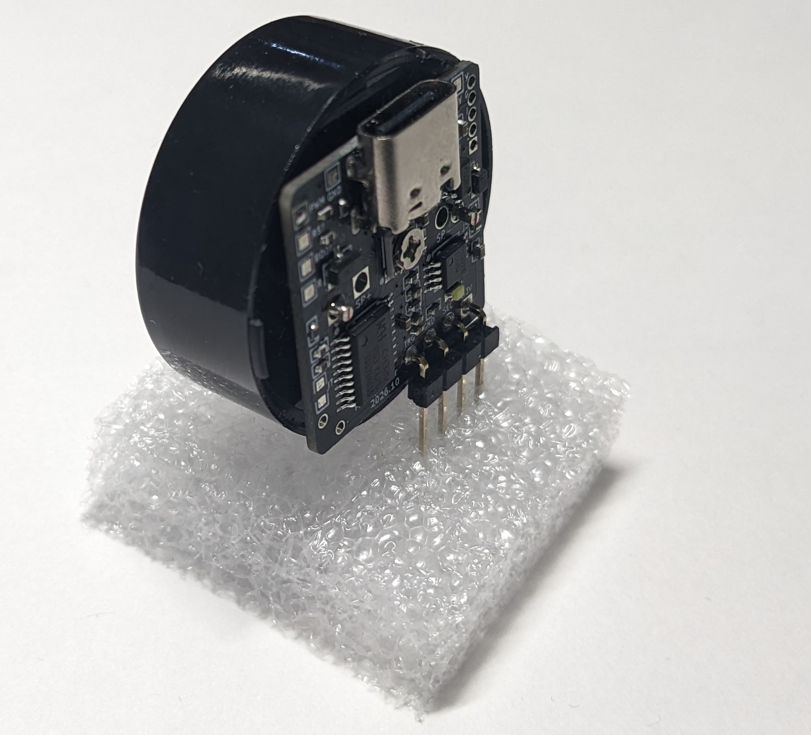
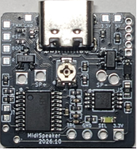

# オーディオアンプ内蔵 9曲入りメロディモジュール [MUSICBOX-MIDI FS-01]



ダイナミックスピーカーを駆動して、楽器9音色＋ドラム5音色で音楽を演奏するメロディモジュールです。
PCからはUSBフラッシュメモリとして認識されて、そこに書き込んだ標準MIDIファイルを順に演奏します。
設定ファイルで、曲・MIDIチャンネルごとに音量、音色、演奏速度を自由に変更できます。
上の写真のように、ケース入りの円形小型スピーカーの背面に直接取り付けられます。

## ■ 仕様

| 項目 | 値 |
|---|---|
| 電源電圧 | 2.4～3.6 V, または5V |
| フラッシュメモリ | 約150 kB (MIDI圧縮再生可) |
| サイズ・質量 | 22×22×3.5mm, 1.7g |

## ■ 構造



USB Type-C、音量調整、アクセスLED、SP+ / SP- (スピーカー接続) と、下表の端子があります。

| 端子 | 方向 | 説明 |
|---|---|---|
| ①, ⑨ | 電源 | GND |
| ②, ⑪ | 電源 | 3V (※) |
| ③ | 電源 | 5V (※) |
| ④ | 出力 | PWM |
| ⑤ | 入力 | RESET |
| ⑥ | 入力 | BOOT |
| ⑦ | 入力 | RECOVER |
| ⑧ | 入力 | トリガ |
| ⑩ | 入力 | モード、進む/戻る |

※ 3Vまたは5Vを給電。5VはUSBから給電してもよい。5Vを給電するとLDOで降圧され3V端子に出力される

SP+ とSP- の間にダイナミックスピーカーを接続し、電源端子またはUSB端子から給電すると、MIDIファイルを演奏します。

## ■ 動作モード

起動時のトリガ端子(⑧)とモード端子(⑩)の状態によって、下記の動作を行います。
⑩ は起動後は「次の曲に進む/前の曲に戻る」を指示する端子になります。

| 起動時のモード端子(⑩) | 起動時のトリガ端子(⑧) | 動作モード |
|---|---|---|
| オープン | オープン | (1) 連続演奏モード |
| オープン | H or L | (2) トリガモード |
| H or L | - | (3) ワンショットモード |

### (1) 連続演奏モード (デフォルト)

⑩と⑧が両方オープンの状態で起動すると、常に演奏を続けます。

※ 演奏中に、⑩にHを入力すると次の曲に進み、Lを入力すると前の曲に戻ります。

### (2) トリガモード

⑩がオープン、かつ⑧がH or Lの状態で起動すると、トリガ入力⑧がLの期間は演奏し、Hになると停止します。

※ 演奏中に、⑩にHを入力すると次の曲に進み、Lを入力すると前の曲に戻ります。

接続例:

- 演奏SW: ⑧ と ⑨ (GND) の間
- 4.7k の抵抗: ⑧ と ⑪ (3V) の間 (⑧をHにしてトリガモードで起動するための抵抗)
- 進む/戻るSW: ⑩ を ⑪ (3V) または ⑨ (GND) に接続

### (3) ワンショットモード

⑩がH or Lの状態で起動すると、トリガ入力⑧がLになるたびに、１曲を最後まで演奏し停止します。

接続例:

- 1曲演奏SW: ⑧ と ⑨ (GND) の間
- ⑩ を ⑪ (3V) または ⑨ (GND) に接続

## ■ 設定ファイルMIDI.TXT

```
# MIDI.TXT Example
SONG(1).FILE=MYSONG1.MID   # 1曲目のファイル名
SONG(1).SPEED=120          # 速度120%
SONG(1).CH(1).VOL=3        # CH1の音量を +3dB
SONG(1).CH(2).INST=FLUTE   # CH2 の音色をフルートに
SONG(2).FILE=MYSONG2.MID   # 2曲目のファイル名
SONG(2).ALL.VOL=-6         # 全CHの音量を -6dB
SONG(2).START=20           # 20秒目から開始
SONG(2).LEN=60             # 開始から60秒間演奏
```

設定ファイルMIDI.TXT で演奏方法をカスタマイズできます。指定に間違いがある行は無視されます。
音色には以下の値を指定できます。

`TUNINGFORK`, `XYLOTONE`, `SAW`, `CLARINET`, `SQUARE`, `PIANO`, `VIOLIN`, `FLUTE`, `ORGAN`, `MUTE`(無音)

## ■ 注意

- ピエゾスピーカーではほとんど音が出ません。4～32Ωのダイナミックスピーカーを使用してください。
- MIDI.TXT 内で指定できるファイル名は8+3形式のみです。ロングファイルネームは指定できません。
- 起動時に⑩がオープンでないと (3) のワンショットモードで起動します。

(2026/10/29)
